# 🍔 TummyFull —  Java Full-Stack Food Delivery Web Application

A complete, production-style food delivery platform for Bangalore restaurants, built entirely with **core Java EE** — Servlets, JSP, JDBC, and MySQL — with **no Spring, no Hibernate, and no Maven**. Three fully separate portals (Customer, Admin, Delivery Agent), Gmail-based OTP authentication, session-based cart/checkout, a real Razorpay payment integration, and a generated PDF invoice system.

Built as a hands-on demonstration of classic Java EE architecture: the DAO design pattern, `PreparedStatement`-only JDBC, filter-based route protection, and server-rendered JSP views — the stack most Java web apps ran on before Spring Boot became the default.

---

## ✨ Features

**Customer**
- Registration + Gmail OTP email verification, login, forgot/reset password (OTP-based)
- Browse restaurants (search, category filter, top-rated/fast-delivery sort)
- Menu browsing with veg/non-veg filter and price sort
- Session-based cart (one restaurant at a time, live quantity steppers)
- Checkout with platform fee, delivery fee, GST, and coupon code support
- **Real payment integration via Razorpay** (UPI / Credit / Debit Card) alongside Cash on Delivery
- Live order status tracking (Placed → Accepted → Preparing → Out for Delivery → Delivered)
- **Downloadable PDF invoice** per order (Apache PDFBox)
- Order history, profile & address management, restaurant/food reviews

**Admin**
- Dashboard: total orders, revenue, users, restaurants, active deliveries, best-seller, monthly sales, pending orders
- Manage Restaurants, Menu Items, Categories, Offers & Coupons, Reviews
- Manage Users (block/unblock, view order history)
- Manage Orders (status changes, delivery agent assignment)
- Manage Delivery Agents

**Delivery Agent**
- Registration + OTP verification, login
- Dashboard of assigned orders with one-tap status progression (Accept → Pick Up → Start Delivery → Mark Delivered)
- Availability toggle (Available/Unavailable)

---

## 🛠️ Tech Stack

| Layer | Technology |
|---|---|
| Backend | Java Servlets (Jakarta EE 10), JSP, JSTL |
| Data access | JDBC with the DAO design pattern, `PreparedStatement` everywhere (no ORM) |
| Database | MySQL 8 |
| Auth | jBCrypt password hashing, Gmail SMTP OTP via Jakarta Mail + Angus Mail |
| Payments | Razorpay (server-side order creation + signature verification, pure JDK `HttpClient` — no SDK dependency) |
| PDF generation | Apache PDFBox |
| Frontend | HTML5, CSS3 (custom design system, no Bootstrap), vanilla JavaScript |
| Server | Apache Tomcat 10.1 |

No frameworks like Spring/Hibernate and no build tool like Maven/Gradle — dependencies are plain JARs in `WEB-INF/lib`, servlets are mapped explicitly in `web.xml` (no `@WebServlet` annotations), by design, to keep the project a clear demonstration of the underlying Java EE mechanics.

---

## 📂 Project Structure

```
TummyFull/
├── sql/tapfood_schema.sql        # Full schema + seed data (5 restaurants, 30+ menu items, 20 users, etc.)
├── src/com/tap/
│   ├── model/       # POJOs: User, Restaurant, Menu, Order, Cart, Payment, OTP...
│   ├── dao/         # DAO interfaces
│   ├── daoimpl/     # JDBC implementations
│   ├── util/        # BCrypt, Mail/OTP, Razorpay, DB connection, validation
│   ├── filter/       # Role-based route protection (Customer/Admin/Agent)
│   ├── listener/     # App startup listener
│   └── servlet/      # ~30 servlets covering every flow above
├── WebContent/
│   ├── WEB-INF/web.xml, lib/, jsp/{user,admin,delivery}/
│   ├── css/, js/
│   └── index.jsp, login*.jsp, register.jsp, otp-verify.jsp, ...
└── Dockerfile
```

---

## 🚀 Setup

See **[SETUP.md](./SETUP.md)** for the full step-by-step guide (required JAR downloads, database setup, Gmail/Razorpay configuration, demo credentials).

Quick version:
1. Run `sql/tapfood_schema.sql` in MySQL.
2. Download the required JARs into `WebContent/WEB-INF/lib/` (links in SETUP.md).
3. Set your Gmail app-password (`MailUtil.java`) and Razorpay test keys (`RazorpayUtil.java`).
4. Import as an Eclipse Dynamic Web Project on Apache Tomcat 10.1, and run.

**Demo credentials** (all seeded with real bcrypt hashes):
| Role | Email | Password |
|---|---|---|
| Admin | admin@tummyfull.com | Admin@123 |
| Delivery Agent | ravi.agent@tummyfull.com | Agent@123 |
| Customer | (any seeded user, e.g. aditi1@example.com) | User@123 |

---

## ☁️ Deployment

This is a server-rendered Servlet/JSP app with a live MySQL connection — it needs an actual Java server, so **static hosts like Netlify/Vercel won't run it**. It's Dockerized for platforms like **Railway** or **Render** that support container deployment:

```bash
# 1. Export TummyFull.war from Eclipse (File -> Export -> WAR file)
# 2. Place it next to the Dockerfile
docker build -t tummyfull .
docker run -p 8080:8080 \
  -e DB_URL="jdbc:mysql://<host>:3306/tapfood?useSSL=false&serverTimezone=UTC" \
  -e DB_USER="..." \
  -e DB_PASSWORD="..." \
  tummyfull
```

`DBConnectionUtil` reads `DB_URL` / `DB_USER` / `DB_PASSWORD` from environment variables with local defaults as a fallback, so the same code runs unchanged locally and in production.

---

## 🔒 Security Notes

- All passwords hashed with `BCrypt.hashpw()` / verified with `BCrypt.checkpw()`
- Every SQL query uses `PreparedStatement` — no string-concatenated SQL anywhere
- Role-based `Filter`s block direct URL access to protected pages without the correct login
- OTPs expire after 5 minutes, are single-use, and gate both registration and password reset
- Razorpay payments are verified server-side via HMAC-SHA256 signature check before any order is marked paid — the client is never trusted to self-report payment success

---

## 📸 Screenshots

### 🏠 Landing Page

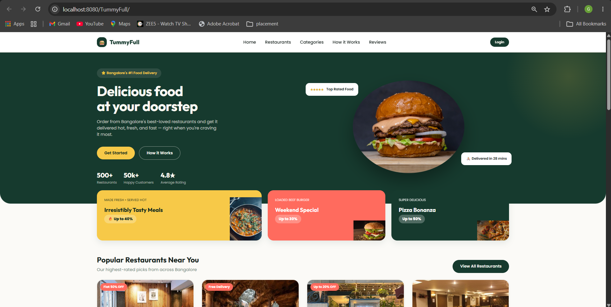

---

### 👤 User Login

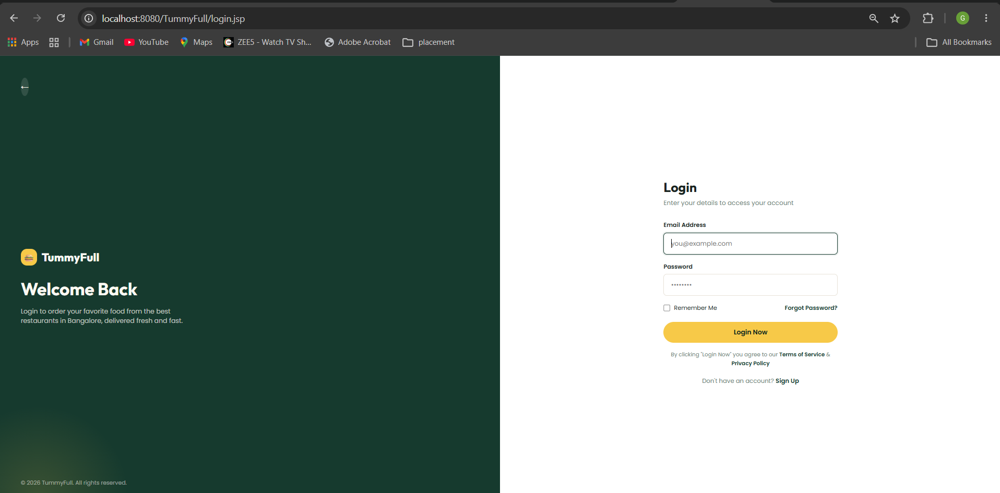

---

### 🍽️ User Dashboard

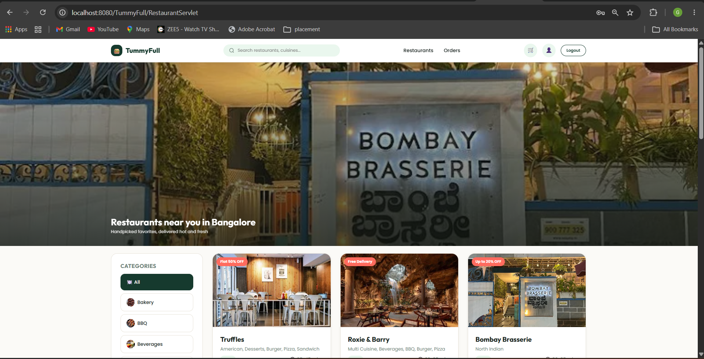

---

### 📖 Restaurant Menu

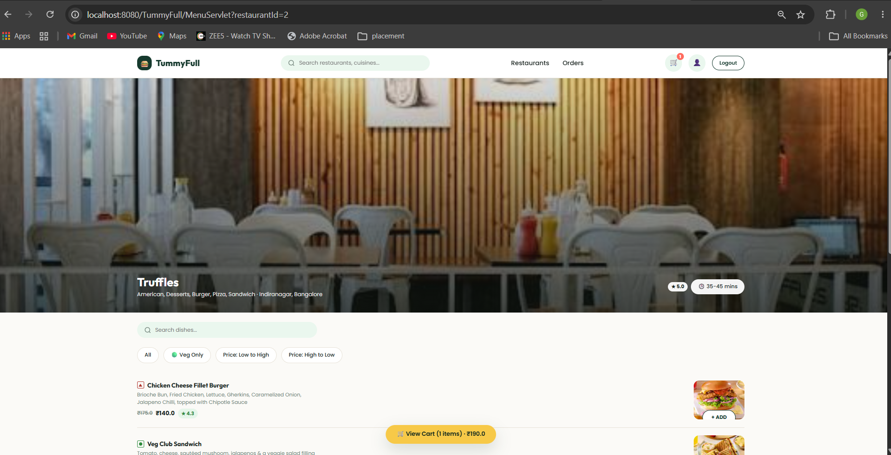

---

### 🛒 Shopping Cart

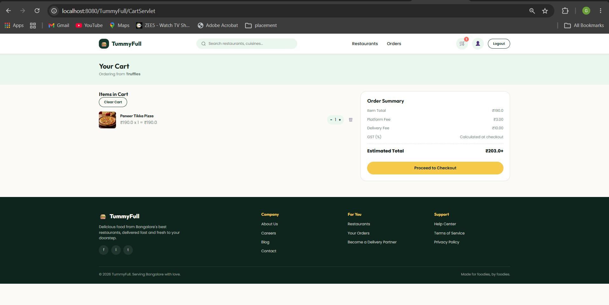

---

### 💳 Checkout

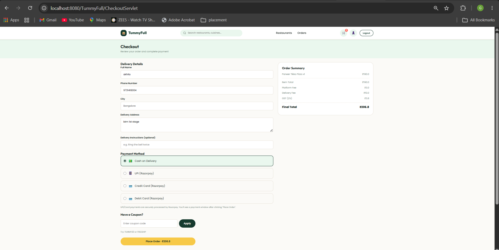

---

### 💰 Payment Page

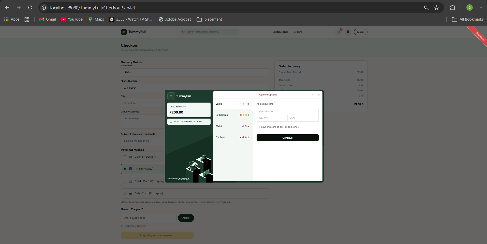

---

### ✅ Order Success

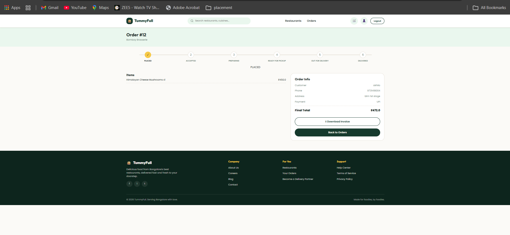

---

### 📄 PDF Invoice

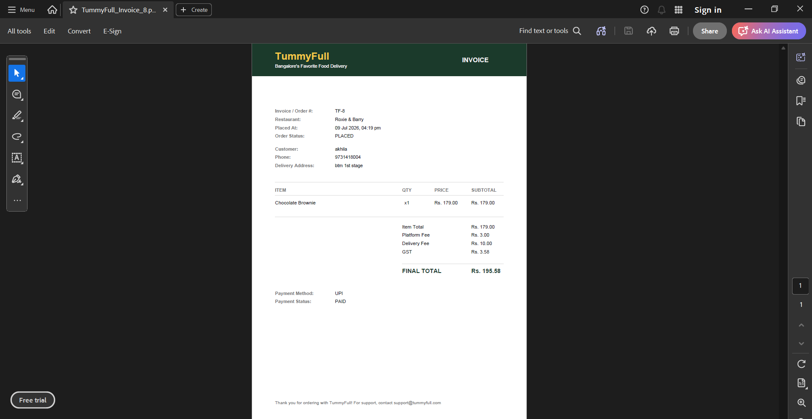

---

### 👤 Edit Profile

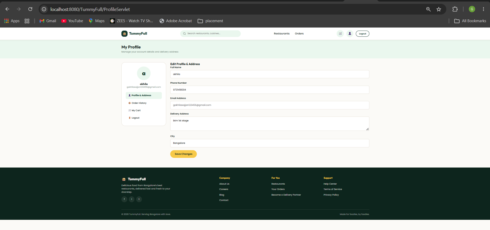

---

### 🔑 Role Login

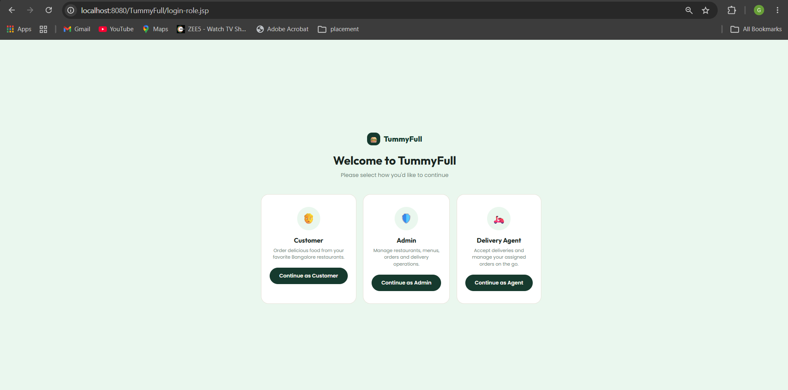

---

### 👨‍💼 Admin Login

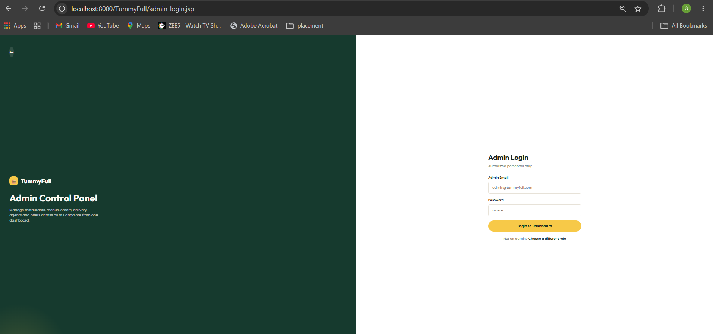

---

### 📊 Admin Dashboard

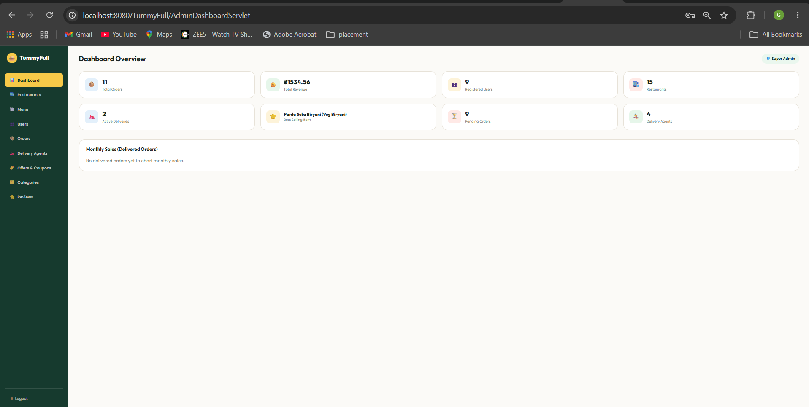

---

### 🍔 Manage Restaurants

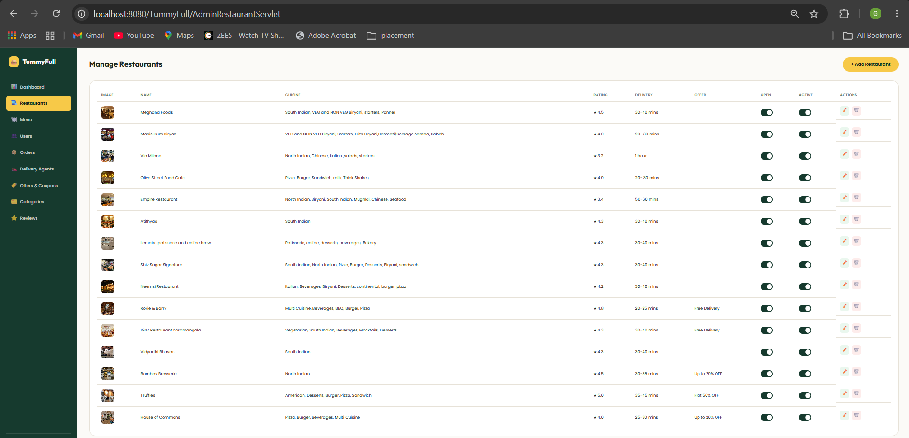

---

### 🍽️ Manage Menu

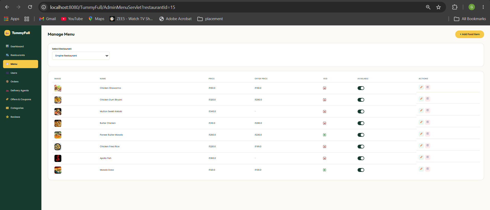

---

### 🚚 Delivery Agent Dashboard

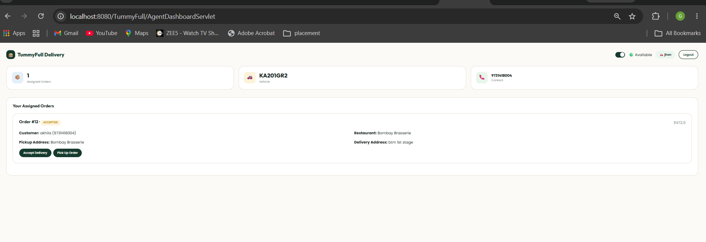

---

### 🔐 OTP Verification

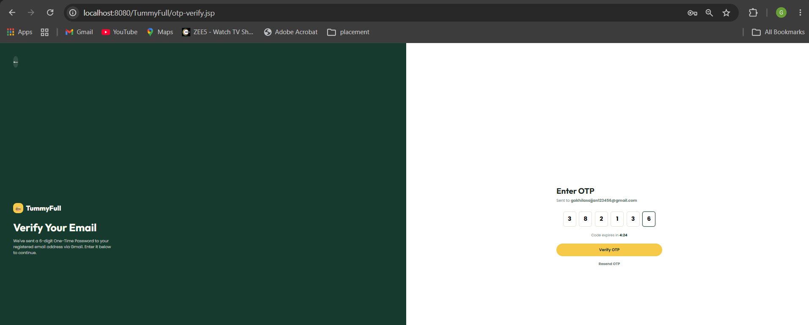

---

## 📄 License

This project was built for educational/portfolio purposes. Feel free to fork and adapt.
